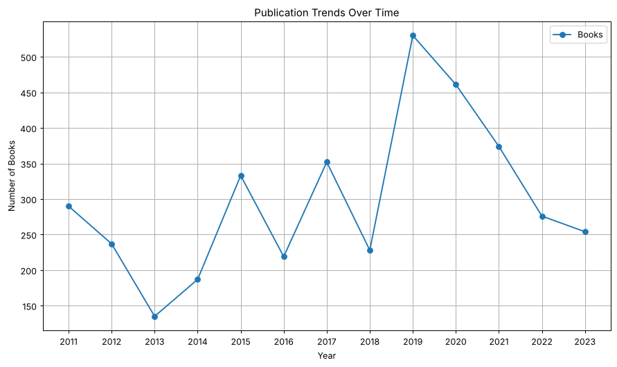
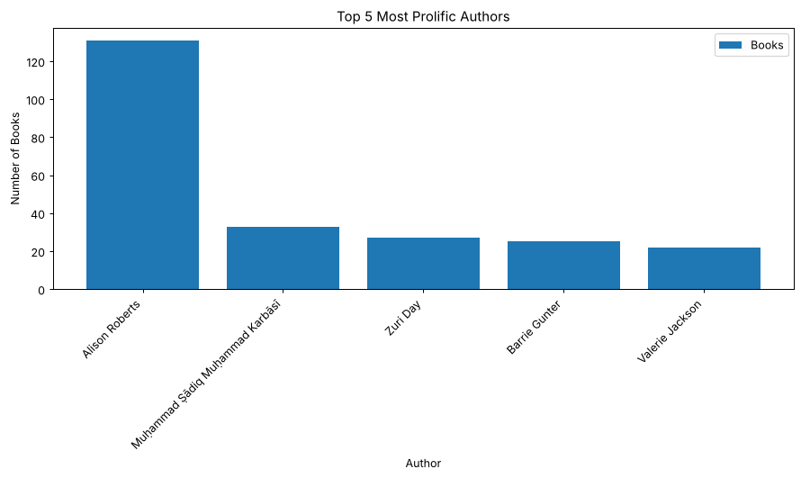
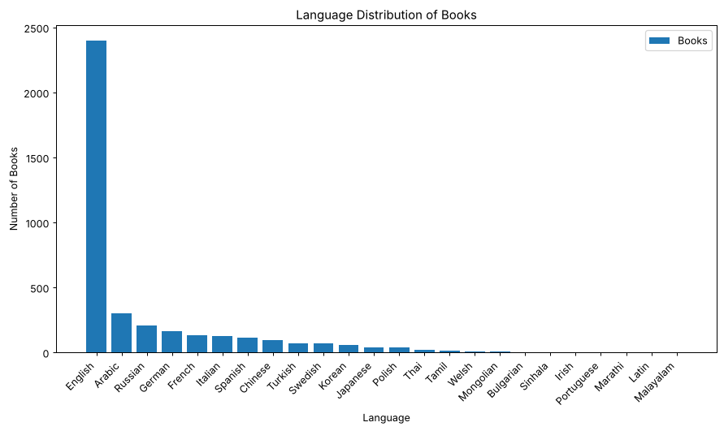
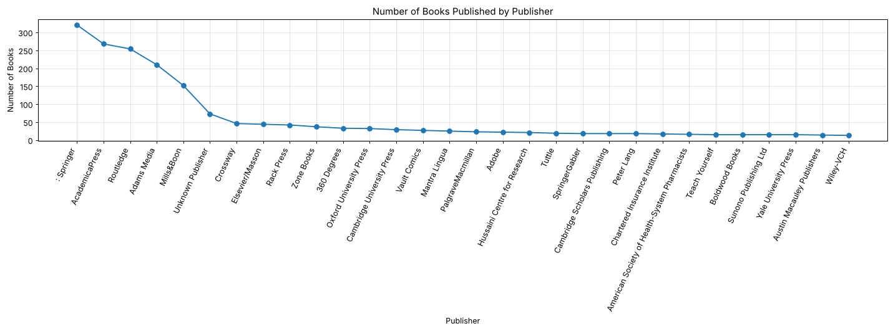
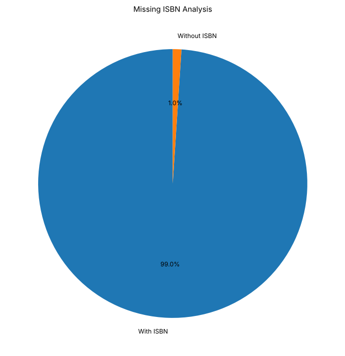
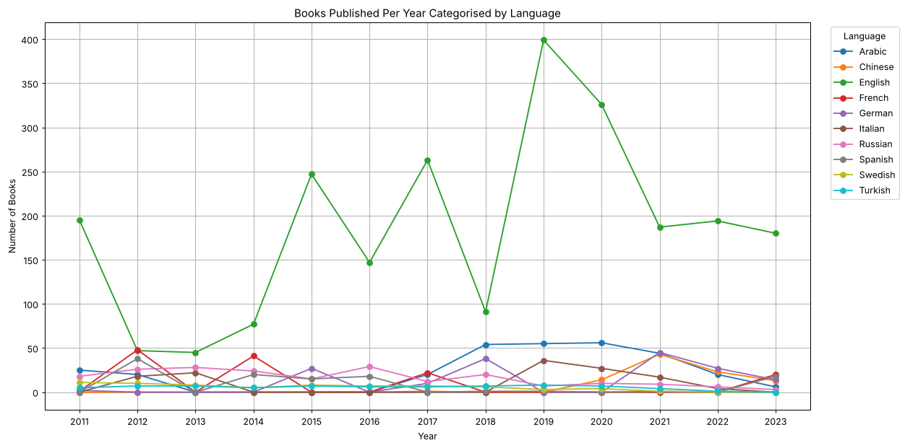
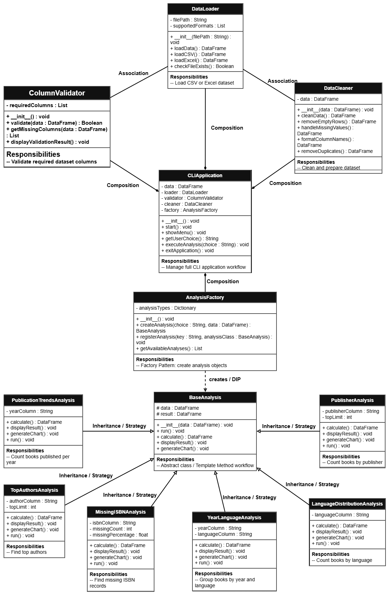

<h1 align="center">📚 Dream Book Shop — Data Analysis System</h1>

<p align="center">
  A Python command-line app that loads, validates and cleans a book dataset, then analyses it with tables and Matplotlib charts —
  designed with <b>OOP, SOLID</b> and the <b>Strategy, Factory Method & Template Method</b> patterns.
</p>

<p align="center">
  
  
  
  
  
</p>

---

## ✨ Features

- 📂 Load data from **CSV or Excel**
- ✅ **Validate** that all required columns exist
- 🧹 **Clean** missing authors, languages, publishers and years; remove empty rows & duplicates
- 📊 Six analyses, each shown as a **terminal table** and a **chart**
- 🖥️ Simple **menu-driven CLI**

```text
Dream Book Shop Analysis Menu
1. Publication Trends Over Time
2. Top 5 Most Prolific Authors
3. Language Distribution of Books
4. Number of Books Published by Publisher
5. Missing ISBN Analysis
6. Books Published Per Year Categorised by Language
7. Show all graphs
8. Exit
```

## 📈 Screenshots

| Publication trends | Top 5 authors | Language distribution |
|---|---|---|
|  |  |  |

| Books per publisher | Missing ISBN | Books per year by language |
|---|---|---|
|  |  |  |

## 🧩 Design

| Pattern / principle | Where |
|---|---|
| **Template Method** | `BaseAnalysis.run()` defines the workflow: `calculate()` → `displayResult()` → `generateChart()` |
| **Strategy** | Each analysis (`TopAuthorsAnalysis`, `PublisherAnalysis`, …) is an interchangeable subclass of `BaseAnalysis` |
| **Factory Method** | `AnalysisFactory` creates the right analysis object from the menu choice |
| **SOLID** | Single-purpose classes (`DataLoader`, `ColumnValidator`, `DataCleaner`), new analyses added without changing existing code, CLI depends on the `BaseAnalysis` abstraction |

### UML class diagram



## 📁 Project structure

```text
Dream_Book_Shop.py          # CLI entry point (menu)
data_loader.py              # DataLoader      – load CSV / Excel
column_validator.py         # ColumnValidator – check required columns
data_cleaner.py             # DataCleaner     – clean & prepare data
analysis_factory.py         # AnalysisFactory – Factory Method
analysis/
  base_analysis.py          # BaseAnalysis    – abstract Template Method
  publication_trends_analysis.py
  top_authors_analysis.py
  language_distribution_analysis.py
  publisher_analysis.py
  missing_isbn_analysis.py
  year_language_analysis.py
tests/                      # 10 pytest test files (22 tests)
books.csv                   # dataset (~3,900 books, 2011–2023)
SYSTEM_SUMMARY.md           # detailed system documentation
```

## 🚀 Run it

```bash
pip install -r requirements.txt
python Dream_Book_Shop.py
```

Run the tests:

```bash
pytest -q
```

## 🗄️ Dataset

`books.csv` with the columns: `book`, `author`, `publication date`, `language`, `book publisher`, `ISBN`, `BNB id`.

---

<p align="center"><sub>Made by <a href="https://github.com/pirathapanakshayan">Pirathapan Akshayan</a></sub></p>
